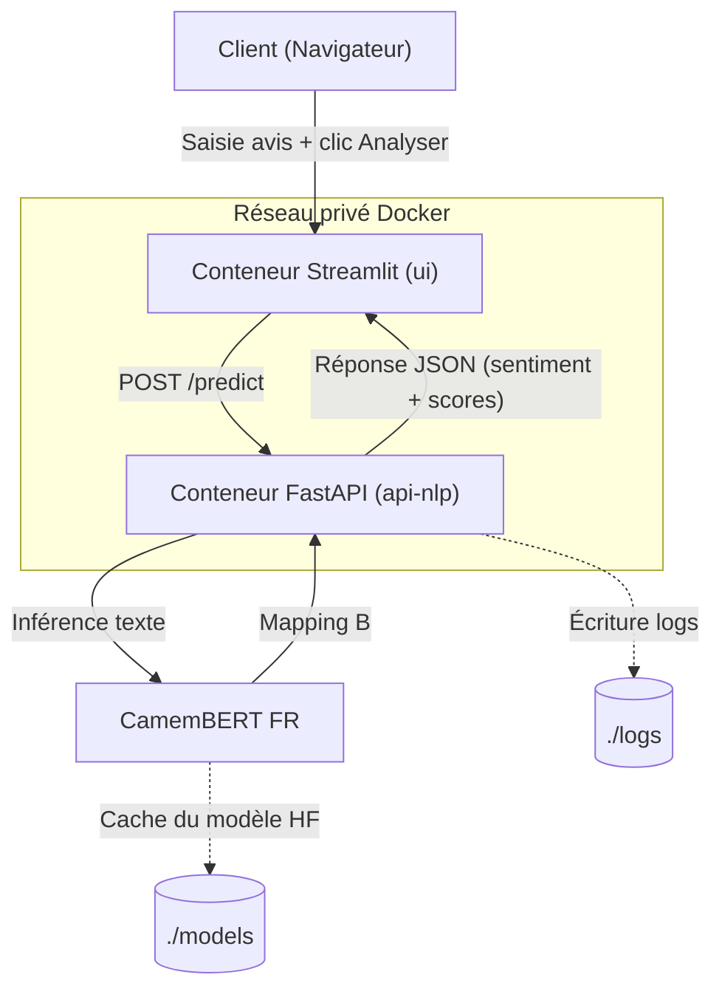

# Analyse & Architecture — Aubergine Hôtels (Sentiment FR)

## 1. Architecture et lancement de la stack (Livrable A)

### Schéma d'architecture

### Lancement de la stack

1. **Configurer les variables d'environnement :**
   `cp .env.example .env`

2. **Construire et démarrer les conteneurs :**
   `docker compose up --build -d`
   *(Le premier démarrage prend quelques minutes pour télécharger le modèle CamemBERT dans `./models`).*

3. **Accéder aux services :**
   * **Interface qualité (Streamlit) :** http://localhost:8501
   * **Documentation interactive de l'API (Swagger) :** http://localhost:8000/docs
   * **Vérification de santé :** http://localhost:8000/health

---

## 2. Analyse des erreurs sur `sample_reviews.csv` (Livrable B)

| Avis testé | Classe attendue | Classe prédite | Cause de l'erreur |
| :--- | :--- | :--- | :--- |
| *"Pas mauvais du tout, on s'attendait à pire vu les avis. Bonne surprise sur le rapport qualité-prix."* | **positif** (ou neutre) | **négatif** | La répétition de négation affecte la réponse du modèle qui intérprète comme un mauvais avis. |
| *"On a passé un séjour qu'on n'oubliera pas. La climatisation en panne en plein août, sympa."* | **négatif** | **neutre** | La le modèle ne comprend pas l'ironie de la phrase et intrèprete mal celle-ci en pensant a un avis neutre alors que le sarcasme affiche un avis négatif |
| *"Petit déjeuner buffet correct mais sans surprise. Chambre propre, literie ferme. Standard."* | **neutre** | **négatif** | Ici c'est directement l'effet du mapping qu'est en cause il est retenu négatif alors que l'avis est neutre de base, cela s'explique par le mapping B |

---

## 3. Justification du mapping (Livrable D)

* **Règle retenue (Mapping B — exigeant) :** `1 star`, `2 stars`, `3 stars` $\rightarrow$ **négatif** ; `4 stars` $\rightarrow$ **neutre** ; `5 stars` $\rightarrow$ **positif**.
* **Justification métier :**
  * Capturer les avis moyens ou mitigés dans la file prioritaire **négatif** permet de détecter et corriger des problèmes généralement pas pris en compte.
  * Placer les avis `4 stars` en **neutre** fera gagné du temps en prétant moins attention a des avis globalement bon.
  * Les études du secteur hôtelier (Cornell University / TripAdvisor) démontrent qu'une note en dessous de 4 fait chuté la moyenne de l'établissement un peu comme si la note 3 était compté directement comme "mauvaise" et pas "neutre".